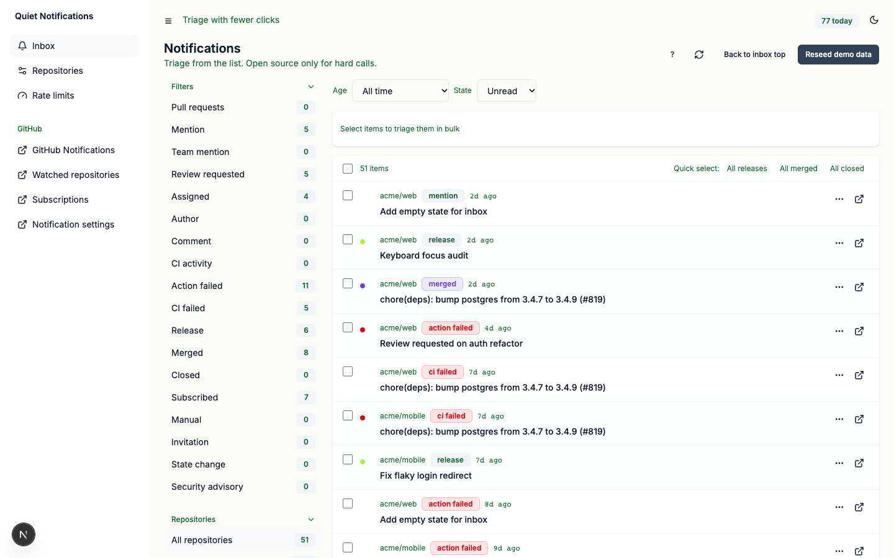
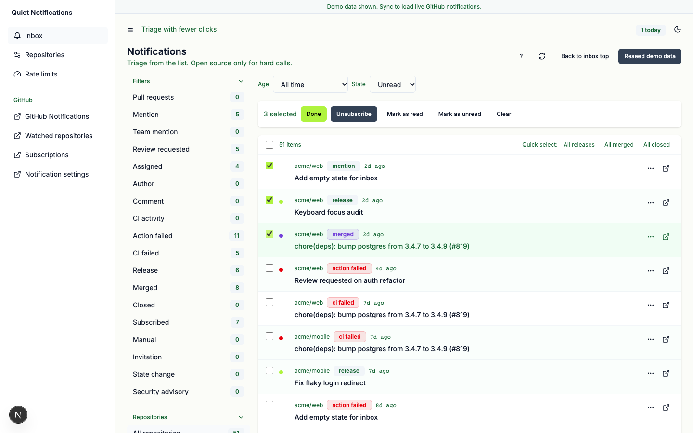
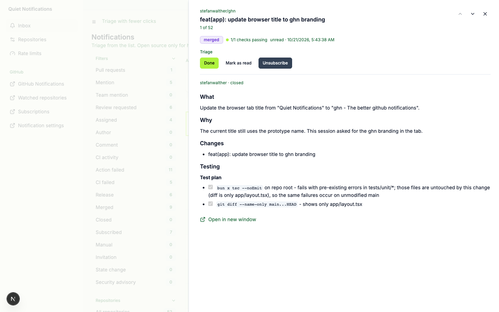
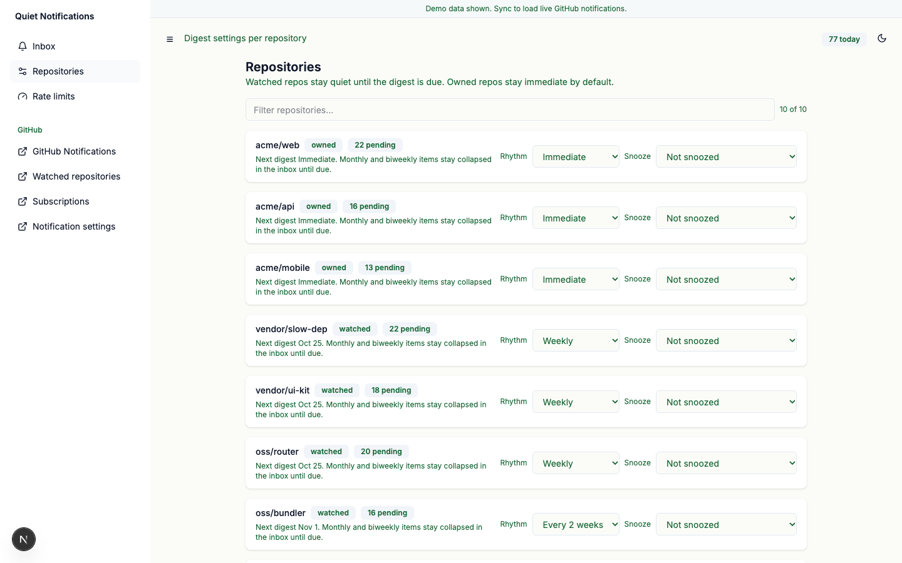
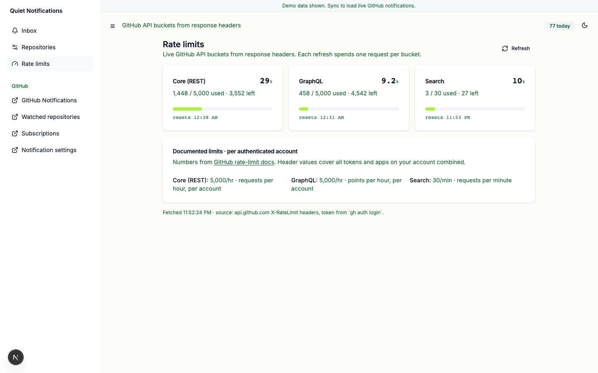

# ghn - the better GitHub notification UI

Clear 20 GitHub notifications in under 5 minutes with half the clicks.

Zero friction. If `gh` works, ghn works. No tokens, no env files.

## Why ghn

- **Fewer clicks** - bulk select and clear 20 threads in one action. Full keyboard flow, no mouse needed.
- **Quicker insights** - no more jumping to a PR or Action to decide. Thread body, checks, and Dependabot detail show inline in the drawer.
- **Clever filtering** - slice by repo, type, age, and read or done state. The queue narrows to what matters now.
- **Clever snoozing** - daily or weekly digests per repo, plus snooze for an hour, this evening, or next week.
- **No API key wrangling** - reuses your `gh` login. No tokens to copy, no env files to maintain.

## Get going

Needs Bun and an authenticated `gh`, nothing else. Tested on macOS and Linux.

```bash
git clone https://github.com/stefanwalther/ghn.git
cd ghn
bun install
bun run dev
# open http://localhost:21120
```

1. Press refresh to sync from GitHub.
2. Clear the queue: filter by repo or reason, select with `x`, press `e` for done.
3. Silence one noisy repo in `/repos` by setting it to weekly.

Trying it out? `bun run db:seed` loads demo data instead of syncing.

## Screenshots

<picture>
  <source media="(prefers-color-scheme: dark)" srcset="docs/screenshots/inbox-dark.png">
  
</picture>

<picture>
  <source media="(prefers-color-scheme: dark)" srcset="docs/screenshots/inbox-selected-dark.png">
  
</picture>

<picture>
  <source media="(prefers-color-scheme: dark)" srcset="docs/screenshots/inbox-drawer-dark.png">
  
</picture>

<picture>
  <source media="(prefers-color-scheme: dark)" srcset="docs/screenshots/repos-dark.png">
  
</picture>

<picture>
  <source media="(prefers-color-scheme: dark)" srcset="docs/screenshots/rate-limits-dark.png">
  
</picture>

## How it works

Three pages, one local SQLite database, all sourced from the GitHub Notifications API.

- `/` - unified inbox with main flow plus collapsed digest section
- `/repos` - per-repo rhythm (immediate, weekly, biweekly, monthly) plus snooze
- `/rate-limits` - live API quota from response headers

Press `?` in the app for all keyboard shortcuts.

## ghn vs github.com/notifications

| | GitHub | ghn |
|---|---|---|
| Time to clear 20 items | 10 plus minutes of per-thread opens | Under 5 minutes from one list |
| Watched repo noise | Every update interrupts | Hidden until the digest is due |
| Return from a thread | Filter and scroll position lost | Same filter and position kept |
| Setup and auth | Token hunt and expiry | Existing `gh` login, nothing to store |
| Sync stalls | Silent or cryptic | Labeled stale state plus quota view |

## Development

See [docs/development.md](docs/development.md) for gates, commands, and layout.

## Contributing

Issues and small PRs welcome. See [open issues](https://github.com/stefanwalther/ghn/issues) for starters. CI runs typecheck, lint, and unit tests on every PR.

## License

MIT. See [LICENSE](LICENSE).
